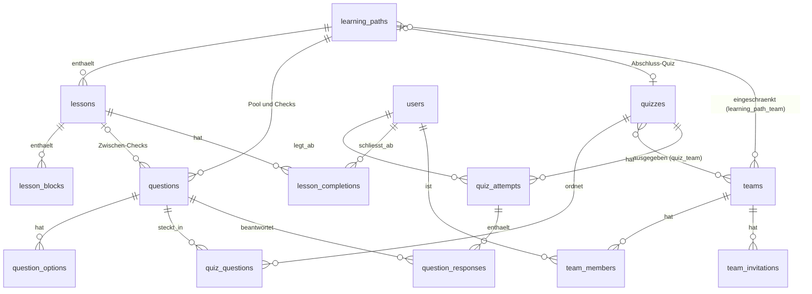

# Domänenmodell

Diese Seite erklärt Begriffe und Regeln von LEARN für alle, die am Code
mitarbeiten. Das vollständige Schema steht in `database/migrations`, die Modelle in
`app/Models`.

## Begriffe

| Begriff | Modell | Bedeutung |
| --- | --- | --- |
| Lernpfad | `LearningPath` | Abgeschlossenes Thema mit Lernzielen, Lektionen, Fragen und einem Abschluss-Quiz. Reihenfolge über `position`, adressiert über `slug`. |
| Lektion | `Lesson` | Lesbarer Abschnitt eines Pfades, besteht aus Blöcken. |
| Block | `LessonBlock` | Typisierter Inhalt einer Lektion (`LessonBlockType`): `markdown`, `callout`, `accordion`, `code_snippet`, `diagram`, `media`, `glossary`, `section_break`. Der Inhalt liegt als JSON in `content`, geprüft von `App\Rules\LessonBlockContent`. |
| Frage | `Question` | `single`, `multiple` oder `boolean` (`QuestionType`), mit Optionen (`QuestionOption`) und einer Erklärung. |
| Zwischen-Check | `Question` mit `lesson_id` | Frage in einer Lektion, wird sofort aufgelöst und nicht gewertet. |
| Freie Frage | `Question` ohne Pfad | Frage, die keinem Pfad gehört und nur in freien Quizzen vorkommt. |
| Pool-Frage | `Question` mit `learning_path_id`, ohne `lesson_id` | Frage des Pfades für Abschluss-, freie und Übungsquizze. |
| Quiz | `Quiz` | Geordnete Fragenliste (`quiz_questions`) mit Bestehensgrenze. Arten siehe unten. |
| Versuch | `QuizAttempt` | Ein Durchgang eines Lernenden durch ein Quiz, mit Punktzahl. |
| Antwort | `QuestionResponse` | Gewählte Optionen zu einer Frage innerhalb eines Versuchs. |
| Lektionsabschluss | `LessonCompletion` | Ein Lernender hat eine Lektion zu Ende gelesen. |
| Quelle | `ContentSource` | Metadaten einer Lernquelle (`pdf`, `slides`, `web`), eindeutig über `source_id`. |
| Beleg | Spalte `source_reference` | An Lektion und Frage: Liste aus `source_id` und genau einer Fundstelle (`page`, `slide` oder `section`). |
| Gruppe | `Team` | Meist ein Jahrgang; Lernende gehören genau einer an. Mitgliedschaft über `Membership` (`team_members`). |
| Einladung | `TeamInvitation` | Offene Einladung in eine Gruppe, gültig 30 Tage. |

Quizarten (`QuizKind`):

- `path_final`: Abschluss-Quiz eines Pfades.
- `custom`: freies Quiz, pfadübergreifend, wird Gruppen ausgegeben (`quiz_team`).
- `practice`: Übungsquiz, persönlicher Behälter genau eines Lernenden.

## Kerntabellen

Die Belege verweisen über `source_id` auf `content_sources`, ohne Fremdschlüssel,
weil sie als JSON an Lektionen und Fragen hängen. Die Tabelle `path_progress`
existiert, wird aber nicht benutzt: Fortschritt wird live berechnet.

## Status und Freigabe

Ein Lernpfad hat zwei unabhängige Felder:

- `status` (`PathStatus`): `draft` oder `published`, in der Oberfläche „Nicht
  sichtbar“ und „Sichtbar“ (gilt ebenso für Quizze).
- `review_status` (`ReviewStatus`): `unreviewed` oder `verified`, also ob ein Admin
  die Inhalte gegen die Belege geprüft hat. Dazu `verified_at` und `verified_by`.

Für Lernende sichtbar ist ein Pfad nur mit beidem
(`LearningPath::isVisibleToLearners()`, Scope `visibleToLearners`). Dazu kommt die
Gruppe: Lernende sehen einen Pfad nur, wenn er ihrer Gruppe in
`learning_path_team` zugewiesen ist; ohne Zuweisung sieht ihn niemand. Persönliche
Teams geben keinen Zugang. Pfade, die vor dem 2026-10-30 angelegt wurden, hat die
Migration `…_assign_existing_learning_paths_to_all_groups` allen damals
bestehenden Gruppen zugewiesen.
Für einen bestimmten Lernenden gilt deshalb `LearningPath::isVisibleTo()` bzw. der
Scope `visibleTo`. Quizze haben einen eigenen `status`.

Wird eine Zuweisung entzogen, bleibt der Fortschritt erhalten; der Pfad ist nur
nicht mehr sichtbar und kommt mit einer neuen Zuweisung samt Fortschritt zurück.
Wird eine Gruppe endgültig gelöscht, fallen ihre Zuweisungen mit weg. War sie die
einzige, sieht den Pfad danach niemand mehr. Zuweisungen sind
Betriebsdaten und reisen nicht im Content-Export mit.

`LearningPath::changedSinceVerification()` vergleicht das jüngste `updated_at` von
Pfad, Lektionen, Blöcken und Fragen mit `verified_at`. Es entwertet die Freigabe
nicht, sondern speist nur den Hinweis „Seit Freigabe geändert“.

## Regeln, die der Code durchsetzt

| Regel | Wo |
| --- | --- |
| Ein `path_final`-Quiz hat einen Lernpfad, jede andere Quizart keinen. Kein DB-CHECK: Schreibende Stellen dürfen die Model-Events nicht umgehen (`saveQuietly()`, `withoutEvents()`). | `Quiz::boot()`, saving-Guard |
| Ein Abschluss-Quiz enthält nur Pool-Fragen des eigenen Pfades. | `Quiz::questionsOutsidePoolOf()`, `Question::isPoolQuestionOf()`, Quiz-Editor |
| Zwischen-Checks sind je Lektion und Position eindeutig, Pool-Fragen je Pfad und Position. | partielle Unique-Indizes, Migration `…_add_import_key_unique_indexes_to_questions_table` |
| Sichtbar schalten, Sortieren und Freigeben ändern `updated_at` nicht, damit sie nicht als Inhaltsänderung gelten. | `SetPathStatus`, `sortPaths()` in `admin/learning-paths/⚡index`, Freigabeansicht |
| Wird eine Lektion gelöscht, wandern ihre Zwischen-Checks in den Pool. | `admin/learning-paths/⚡edit`, `deleteLesson()` |
| Gemischte Quizze und Übungsquizze frieren die Fragenliste je Versuch ein, damit alte Versuche gegen ihre eigenen Fragen gewertet bleiben. | `Quiz::freezesQuestionOrder()`, `quiz_attempts.question_order` |
| Übungsquizze ziehen nur Fragen aus Pfaden, die der Lernende sieht. | `BuildPracticeQuiz` |
| Lernende sehen nur Pfade, die ihrer Gruppe zugewiesen sind; das gilt für Pfad, Lektionen, Abschluss-Quiz, Weiterlernen und Fortschritt. | `LearningPath::visibleTo()`, `LearningPathPolicy`, `QuizPolicy` |
| Die Gruppenauswertung zählt je Gruppe nur die Pfade, die diese Gruppe sieht. | `GroupProgressReport` |
| Der Content-Import legt nur an; ein vorhandener Slug ergibt eine Kopie. Status und Freigabe setzt der Import selbst auf nicht sichtbar und ungeprüft, Gruppen weist er keine zu. | `ImportLearningPath::create()` |
| Reihenfolge-Änderungen an Pfaden laufen unter einem gemeinsamen Lock. | `ImportLearningPath::ORDER_LOCK` |
| Ein Admin löscht in der Nutzerliste nicht sein eigenes Konto. Der letzte Admin lässt sich weder dort noch über die Selbstlöschung löschen; die verbindliche Prüfung sperrt die Admin-Zeilen in der Transaktion. | `User::isDeletableBy()`, `DeleteUser` |
| Gespeichert werden nur Lernergebnisse, kein Nutzungsverhalten. | `.ai/rules/app.md` |

## Content-Format und Schema-Version

Lernpfade reisen als JSON. Das Format beschreibt der Skill
[`learn-content`](../.ai/skills/learn-content/references/format.md). Die Datei trägt
eine `schema_version` (`ValidateContentFile::SCHEMA_VERSION_CURRENT`); ab Version 2
steht ein `sources`-Block mit den Quellen in der Datei, Version 3 erlaubt Bilder im
ZIP-Bündel. Eine Formatänderung, die ältere Leser falsch verstünden, braucht eine
neue Version.

Zur Laufzeit prüfen Formulare, Freigabe, Upload und Export Quellen gegen
`content_sources` (`LoadContentSourceRegistry`). Das Quellenarchiv der lokalen
Pipeline (`LoadSourceRegistry`) ist ein reines Autorenwerkzeug.
